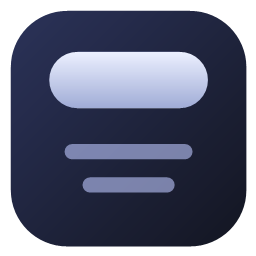
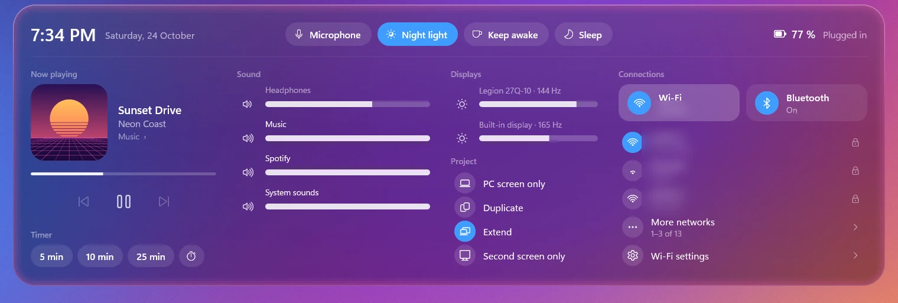
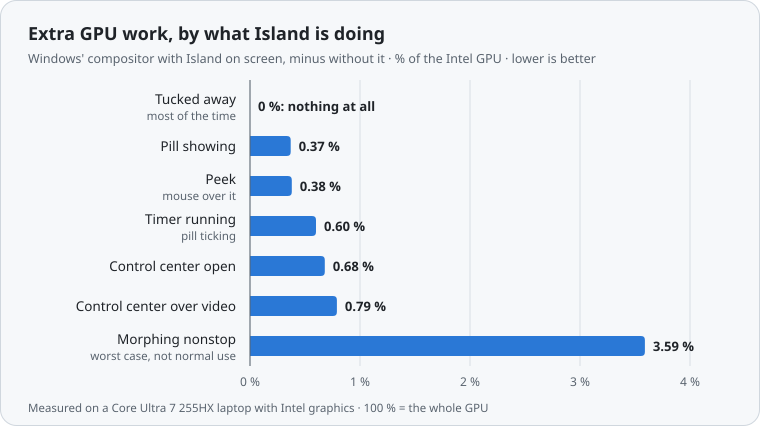
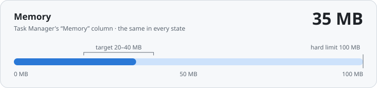

<div align="center">



# 🏝️ Island

### A Dynamic Island for Windows ✨

A little glass pill at the top of your screen that shows what's playing 🎵, runs your timers ⏱️,<br>
and opens into a full control center 🎛️. And the moment a game goes fullscreen, it's gone. 🎮💨


<br>


<sub>The pill 👉 hover for <b>Peek</b> 👉 click for the <b>control center</b> 👉 and back. A real screen recording; only the Wi‑Fi names are blurred.</sub>

</div>

<br>

## ✨ What it does

| Feature | What you get |
|---|---|
| 🎵 **Now playing** | Album art, title and artist, play / pause / skip, a progress line. Works with Spotify, browsers, Media Player and any app that shows up in Windows' own media controls. Several apps playing? Pick one. |
| 🎚️ **Sound** | Your output volume plus a **per-app mixer** (turn Discord down without touching Spotify). |
| ☀️ **Brightness** | For the laptop screen *and* external monitors (most monitors support it over DDC/CI; no extra software needed). |
| 📶 **Wi‑Fi & Bluetooth** | Turn them on and off, see the networks around you and join one, connect or disconnect your headphones and speakers. |
| 🖥️ **Displays** | PC screen only · Duplicate · Extend · Second screen only, one click away. |
| ⏱️ **Timer & stopwatch** | 5 / 10 / 25 minutes or a stopwatch. While it runs, the pill **stays on screen** with the time ticking. A chime when it's done. |
| 🔋 **Charging moment** | Plug the charger in and a little battery fills up in the pill for 3 seconds. |
| 🎙️ **Quick toggles** | Mute the microphone, Night light, Keep awake (no screen sleep), and a **Sleep** button that locks and sleeps the PC. |
| 🫥 **Out of your way** | Hides like an auto-hide taskbar: push the mouse to the top-middle to bring it down. |
| 🎮 **Game-safe** | Vanishes within **10 ms** when anything goes fullscreen, and never steals focus from your game. |
| 🧊 **Feels nice** | Live see-through glass, springy morphs that change direction smoothly, ripples where you click, rolling digits. |

<br>

## 📸 Screenshots

<table>
  <tr>
    <td align="center"><br>🎶 <b>The pill</b>, while music plays</td>
    <td align="center"><br>👀 <b>Peek</b>: rest the mouse on it</td>
  </tr>
  <tr>
    <td align="center"><br>⏱️ <b>A timer</b> counting down</td>
    <td align="center"><br>⏸️ <b>Hover the timer</b> to pause or stop it</td>
  </tr>
  <tr>
    <td align="center"><br>🔌 <b>Plugged in</b>: the charging moment</td>
    <td align="center">🫥 <b>And most of the time…</b><br>it's tucked away out of sight,<br>using <b>nothing at all</b>.</td>
  </tr>
</table>

**🎛️ The control center** (click the pill):



<br>

## 🚀 Install it

> [!NOTE]
> There's no ready-made download yet, so you build it yourself. It's **one command** once the tools are installed. Allow about 15 minutes, most of it spent downloading Visual Studio.

### 🧰 1. Get the tools (once)

| You need | Where to get it |
|---|---|
| 🪟 **Windows 11**, 64-bit | (Windows 10 isn't tested) |
| 🛠️ **Visual Studio 2026** (the free Community edition is fine) **or** *Build Tools for Visual Studio 2026* | [visualstudio.microsoft.com](https://visualstudio.microsoft.com/downloads/). In the installer, tick the **Desktop development with C++** workload. That brings the compiler, the Windows SDK and CMake. |
| 🌱 **Git** (optional) | [git-scm.com](https://git-scm.com/download/win), or just use *Code → Download ZIP* on this page |

### 📥 2. Download Island

```powershell
git clone https://github.com/Pranesh-stha/dynamicIslandOnWindows.git
cd dynamicIslandOnWindows
```

<sub>(Downloaded the ZIP instead? Unzip it and open that folder.)</sub>

### 🏗️ 3. Build and install, in one go

Open **Developer PowerShell for VS** (search for it in the Start menu; it knows where CMake and the compiler are), go to the folder, and run:

```powershell
powershell -ExecutionPolicy Bypass -File tools\install.ps1 -Build
```

That's it! 🎉 This builds Island, installs it **for your user only** (no admin rights), adds **Island** to the Start menu and starts it. Now **push your mouse to the very top of the screen, in the middle.** 👆

<details>
<summary>📂 What exactly does the installer do?</summary>

<br>

- Copies `Island.exe` (about 1.4 MB, the whole app) to `%LOCALAPPDATA%\Programs\Island`
- Copies `settings.json` next to it the first time (later installs keep your edits)
- Adds a Start menu shortcut called **Island**
- Starts Island

Nothing goes into Program Files, nothing into the registry, and nothing starts with Windows unless you ask for it (see below).

</details>

### 🔁 Start it with Windows (optional)

Click Island's tray icon (the **^** next to the clock) and tick **Start with Windows**. You can switch it off there again, or in *Task Manager → Startup apps*.

<br>

## 🖱️ How to use it

| You… | Island… |
|---|---|
| 👆 push the mouse to the **top edge, in the middle** | slides down as a little pill |
| 🖱️ rest the mouse on the pill | grows into **Peek**: the song with play / pause and skip |
| 👇 **click** it | opens the **control center** |
| 🏃 move the mouse away | tucks itself away again |
| 🎮 start a game or a fullscreen video | disappears instantly, and comes back when you're done |
| ⏱️ start a timer | stays on screen with the time until you pause or stop it |

**Tray icon** (^ next to the clock): `Start with Windows` · `Open settings.json` · `Open log` · `Keep open (for tuning)` · `Quit Island`.<br>
Closed it? Open it again from the Start menu: search for **Island**. 🔍

<br>

## ⚡ How light is it?

Most of the time Island is tucked away, and then it does **nothing at all**: 🟢 **0 % GPU and 0.00 % of the processor** (it sleeps until you call it). Here's everything else, measured on a gaming laptop (Intel Core Ultra 7 255HX, Intel graphics):

<picture>
  <source media="(prefers-color-scheme: dark)" srcset="docs/images/chart-gpu-dark.svg">
  
</picture>

<picture>
  <source media="(prefers-color-scheme: dark)" srcset="docs/images/chart-ram-dark.svg">
  
</picture>

<details>
<summary>📊 All the numbers as a table (CPU, GPU, RAM, handles)</summary>

<br>

CPU is the share of **one** core (the laptop has 20 threads, so the whole processor sees 1/20 of this). "Extra GPU" is what Windows' compositor (DWM, the part of Windows that draws the screen) does *because of* Island, measured with and without it over the same background. Averages of two runs.

| What Island is doing | CPU (one core) | Extra GPU | RAM | Handles / threads |
|---|---:|---:|---:|---:|
| 🫥 Tucked away (60 s) | 0.00–0.05 % | 0 % | 35 MB | 572 / 38 |
| 💊 Pill showing | ≤ 0.10 % | 0.37 % | 35 MB | ~580 / 42 |
| 👀 Peek | ≤ 0.10 % | 0.38 % | 35 MB | ~576 / 42 |
| ⏱️ Timer running | 0.21–0.31 % | 0.60 % | 35 MB | ~575 / 42 |
| 🎛️ Control center open | 0.10–0.21 % | 0.68 % | 35 MB | ~587 / 42 |
| 🎬 Control center over moving video | ≤ 0.31 % | 0.79 % | 35 MB | ~585 / 42 |
| 🌀 Morphing nonstop (worst case) | 0.73–1.04 % | 3.59 % | 35 MB | ~590 / 42 |

Windows counts CPU time in 15.6 ms steps, so 0.10 % over 15 seconds is a single step, the smallest amount it can see.

</details>

| 🚀 Starts in | 🎮 Hides for fullscreen in | 📦 Size | 🧠 RAM |
|:---:|:---:|:---:|:---:|
| **~0.3 s** | **0–10 ms** | **1.4 MB**, one exe | **35 MB** |

<sub>Measure it on your own PC: `pwsh -File tests\benchmark.ps1` (needs PowerShell 7; hands-free, about 5 minutes).</sub>

<br>

## 🎮 Safe for games

- 🙈 **Hides whenever anything covers your whole main screen:** games in fullscreen or borderless "windowed fullscreen", F11 in a browser, fullscreen video. It comes back half a second after you leave, so quick alt-tabs don't make it flicker.
- 🧘 **Never steals focus.** Clicking Island never takes the keyboard away from your game or your typing.
- 🤝 **Doesn't touch other programs:** no code injection, no global keyboard or mouse hooks, no reading other apps' memory.
- 🖥️ **Two monitors?** A game fullscreen on the *other* screen doesn't hide it.
- 🧯 **Escape hatch:** if a game is ever missed, add its exe name to `games.blocklist` in the settings.

<br>

## ⚙️ Make it yours

Tray icon → **Open settings.json**. Save the file and the change shows up **right away** (no restart). Broke something? Island keeps your previous settings and writes the reason to the log.

| Setting | What it does | Default |
|---|---|---|
| `layout.autoHide` | Tuck away until the mouse touches the top. `false` = always show the pill | `true` |
| `glass.style` | 🧊 `"live"` see-through · `"clear"` iPhone-like lens glass · `"frosted"` Windows' heavy blur | `"live"` |
| `glass.frost` | How much blur goes over the live glass (0 = none, 1 = frosted) | `0.85` |
| `glass.tintOpacity` | How dark the glass is (0 = clear, 1 = solid) | `0.45` |
| `glass.accent` | The "on" color: `"auto"` (your Windows accent) or `"#RRGGBB"` | `"auto"` |
| `games.blocklist` | Exe names that always hide Island, e.g. `["VALORANT-Win64-Shipping.exe"]` | `[]` |
| `motion.morph` | The spring of the shape change: `dampingRatio` (bounce) and `periodMs` (speed) | `0.78`, `65` |

Every option is explained right inside [`config/settings.json`](config/settings.json). 💡 Tip: tray → **Keep open (for tuning)** holds the control center open while you try values.

<br>

## 🔒 Privacy

- 🌐 **Never goes online.** No internet, no telemetry, no account.
- 🔑 **No admin rights**, ever.
- 📝 The log stays on your PC: `%LOCALAPPDATA%\Island\island.log`.
- 🔐 Wi‑Fi passwords are never typed into Island. For a new secured network it opens Windows' own Wi‑Fi list.
- 📷 Only the optional `"clear"` glass looks at the screen behind the island (to blur it); nothing is saved, and the island then hides itself from screenshots. The default `"live"` glass doesn't capture anything.

<br>

## 🧹 Uninstall

```powershell
powershell -ExecutionPolicy Bypass -File tools\uninstall.ps1
```

Removes the app, its Start menu entry and the "Start with Windows" shortcut. Add `-RemoveLog` to delete the log folder too. 👋

<br>

## ❓ Help, something's off

<details>
<summary>😶 I installed it but I don't see anything</summary>

<br>

It's tucked away, like an auto-hide taskbar. Push the mouse **all the way to the top edge, in the middle** of your main screen. You can also check the tray (^ next to the clock) for its icon. Prefer it always visible? Set `layout.autoHide` to `false`.

</details>

<details>
<summary>❌ <code>cmake</code> is not recognized</summary>

<br>

Run the install command from **Developer PowerShell for VS** (Start menu), not a normal PowerShell window. It adds Visual Studio's CMake and compiler to the path. Also check that the **Desktop development with C++** workload is installed.

</details>

<details>
<summary>🚫 "Running scripts is disabled on this system"</summary>

<br>

Use the exact command above. `-ExecutionPolicy Bypass` lets that one script run without changing any setting on your PC.

</details>

<details>
<summary>🎮 It showed up over a game</summary>

<br>

Tell me which game and how it runs (fullscreen / borderless / windowed). Meanwhile, add the game's exe name to `games.blocklist` in `settings.json`, and Island will hide whenever that game is in front.

</details>

<br>

## 🛠️ For developers

<details>
<summary>🏗️ Build, test and project layout</summary>

<br>

**Stack:** C++20, plain Win32, `Windows.UI.Composition` for the visuals and animations, Direct2D / DirectWrite for text, C++/WinRT for Windows APIs. No frameworks, no runtime to install. MSVC only (through the CMake presets).

```powershell
cmake --preset default          # once
cmake --build --preset release  # or: debug
ctest --preset release          # unit tests
```

The `.ps1` test scripts need PowerShell 7 (`pwsh`) and never move your mouse, except `fullscreen_test.ps1`.

| Test | What it checks |
|---|---|
| `ctest` | 228 unit checks (state machine, springs, timer maths, media picking, …) |
| `build\Release\IslandTests.exe --hardware` | real volume, brightness and mixer (moved 1 % and back) |
| `tests\visual_check.ps1` | screenshots of every state, morph timings, hands-free |
| `tests\fullscreen_test.ps1` | hides for fullscreen windows (clicks its own test windows: hands off the mouse ~15 s) |
| `tests\media_test.ps1` | now playing, with a silent test track |
| `tests\timer_check.ps1` | timer, stopwatch and the charging moment |
| `tests\soak_test.ps1` | appear / hide again and again, watching memory and handles |
| `tests\benchmark.ps1` | CPU, RAM and GPU in every state |

```
src/
  platform/   tray icon, settings, log, start with Windows
  render/     glass, springs and motion, widgets, drawing
  services/   media, audio, brightness, Wi-Fi, Bluetooth, displays, power, timer, fullscreen watcher
  views/      the pill, Peek and the control center (and its sections)
tests/        unit tests and the hands-free test scripts
tools/        install / uninstall, icon maker
config/       the default settings.json
```

The whole design, every decision and the test history live in [`PLAN.md`](PLAN.md).

</details>

<br>

<div align="center">

Made with 💜 by [Pranesh-stha](https://github.com/Pranesh-stha)

⭐ **If Island made your Windows a little nicer, a star makes my day!** ⭐

</div>
